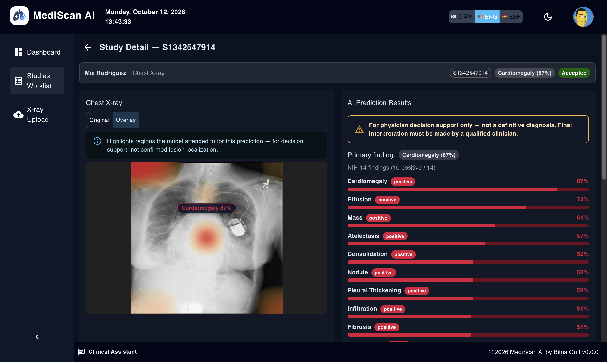
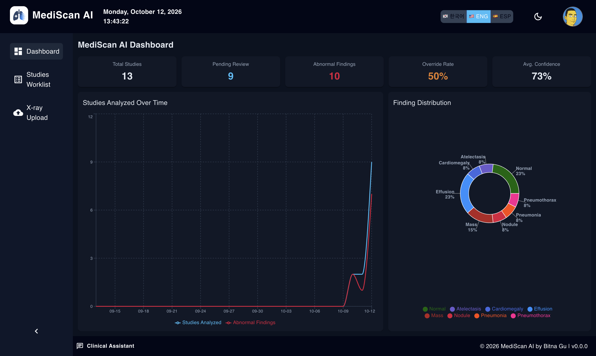
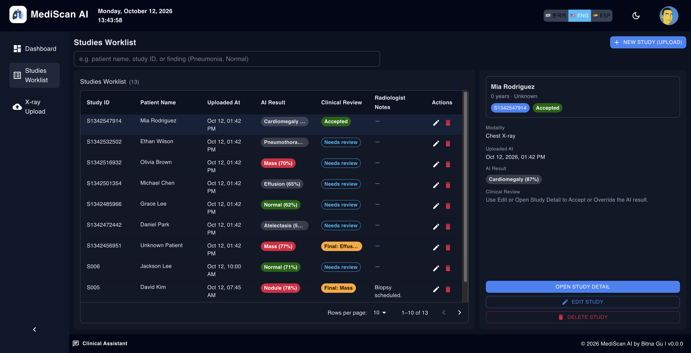
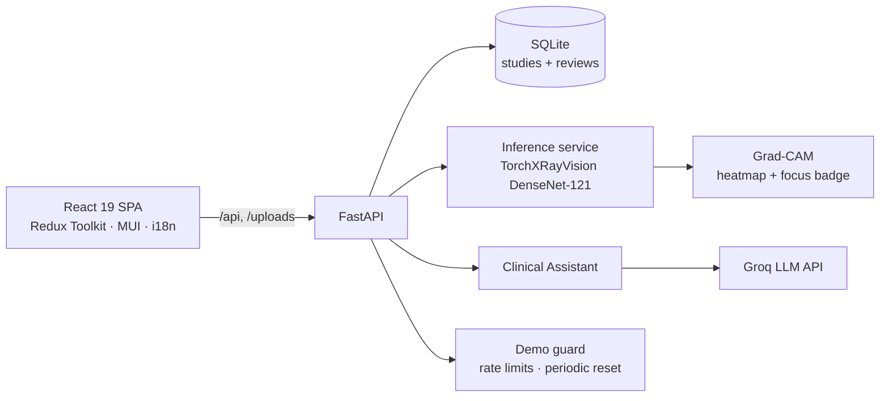

# MediScan AI

AI-assisted chest X-ray screening worklist for radiology workflows. Upload an X-ray, get NIH-14 multi-label findings with a Grad-CAM overlay, and let a radiologist accept or override the AI result before it counts.

**Live demo:** https://mediscan-ai-production-d681.up.railway.app (login `admin` / `admin123`)



## What I built

- **End-to-end AI product:** React worklist and dashboard, FastAPI backend, PyTorch inference with Grad-CAM, Docker deploy to Railway, CI with API and unit tests.
- **Human-in-the-loop review:** radiologists accept or override every AI result; AI output and the final clinical label are stored separately so the override rate is measurable.
- **Model evaluation and operating point:** measured per-pathology AUROC on the full NIH test split (25,596 images) and chose screening thresholds based on how they behave in the worklist, not only on aggregate metrics.

## Screenshots

| Dashboard | Worklist with clinical review |
|--|--|
|  |  |

## Architecture



In production a single Docker container serves the API, uploaded images, and the built SPA from one origin.

## AI/ML

### Data

[NIH ChestX-ray14](https://nihcc.app.box.com/v/ChestXray-NIHCC): 112,120 frontal chest X-rays with 14 disease labels mined from radiology reports. Evaluation uses the official patient-wise `test_list.txt` split.

### Model

[TorchXRayVision](https://github.com/mlmed/torchxrayvision) DenseNet-121 (`densenet121-res224-all`), pretrained on several public chest X-ray datasets.

- **Multi-label output** matches the clinical reality that one X-ray can show several findings, and every NIH-14 class can be explained with its own Grad-CAM.
- **Calibrated outputs:** TorchXRayVision normalizes each pathology so that 0.5 is its validation operating point, which gives a principled default threshold.
- **CPU-friendly:** about 25 ms per image on a laptop, so the demo runs on a free-tier container.

### Evaluation

Full NIH official test split, 25,596 images, same preprocessing as the `/analyze` endpoint. Sensitivity and specificity are at the deployed thresholds.

| Pathology | Positives | AUROC | Sensitivity | Specificity |
|--|--:|--:|--:|--:|
| Hernia | 86 | 0.874 | 0.663 | 0.971 |
| Cardiomegaly | 1,069 | 0.847 | 0.643 | 0.865 |
| Effusion | 4,658 | 0.780 | 0.837 | 0.572 |
| Edema | 925 | 0.774 | 0.615 | 0.760 |
| Mass | 1,748 | 0.736 | 0.954 | 0.213 |
| Atelectasis | 3,279 | 0.717 | 0.797 | 0.504 |
| Consolidation | 1,815 | 0.695 | 0.901 | 0.368 |
| Pleural Thickening | 1,143 | 0.691 | 0.815 | 0.419 |
| Fibrosis | 435 | 0.688 | 0.956 | 0.212 |
| Infiltration | 6,112 | 0.662 | 0.938 | 0.139 |
| Pneumothorax | 2,665 | 0.660 | 0.887 | 0.357 |
| Nodule | 1,623 | 0.657 | 0.882 | 0.231 |
| Pneumonia | 555 | 0.653 | 0.517 | 0.682 |
| Emphysema | 1,093 | 0.597 | 0.741 | 0.387 |
| **Mean** | | **0.717** | | |

Raw output: [`docs/eval/nih_test_auroc.json`](docs/eval/nih_test_auroc.json). Reproduce with:

```bash
cd backend && source .venv/bin/activate
python scripts/eval_nih_auroc.py --archive /path/to/nih-archive --out ../docs/eval/nih_test_auroc.json
```

### Threshold decision

The product is a screening worklist: a missed finding is worse than an extra one a radiologist dismisses. I first auto-tuned per-pathology thresholds (`tune_pathology_thresholds.py`) to maximize exact label-set match. That pushed some cut-offs to 0.85–0.90 (Mass, Pneumonia, Hernia), and on a hand-built 600-image test set most disease images came back as "Normal". A screening tool that hides findings fails its main job, so I went back to the calibrated 0.5 operating point for every class (`backend/models/pathology_thresholds.json`).

The trade-off is visible in the table: sensitivity is high for most findings, but specificity is low for Infiltration, Mass, Nodule, and Fibrosis, so a typical abnormal image shows several positive findings. The UI handles this by ranking findings by score, using the top finding as the summary label, and requiring a human review before a study is final.

### Why the fine-tuned model is not deployed

I also fine-tuned the same DenseNet backbone on NIH as a 4-class classifier (Normal, Nodule, Pneumonia, Other; `train_mediscan_classifier.py`). I kept the pretrained multi-label model instead because:

- Collapsing 14 findings into 4 buckets lost clinical information. "Other" mixed nine unrelated diseases, and "Pneumonia" absorbed Infiltration and Consolidation.
- A single softmax label cannot represent X-rays with several findings, which are common in NIH.
- Grad-CAM on a broad bucket such as "Other" does not tell the radiologist what the model saw.

### Limitations

- **Not an independent validation.** The pretrained weights include NIH ChestX-ray14 in their training data, so overlap with the test split cannot be ruled out and these numbers may be optimistic.
- **Noisy labels.** NIH labels were extracted from reports by NLP, not read by radiologists for this dataset.
- **Patient-level failures.** Several follow-up images of the same patient were all read as Mass, so errors are not independent across studies.
- **Grad-CAM shows attention, not lesion localization.**
- **Not a medical device.** No DICOM support, no real authentication, CPU inference, SQLite. For demonstration only.

## Live demo

Public demo on Railway, single Docker container: **https://mediscan-ai-production-d681.up.railway.app**

| | |
|--|--|
| Login | `admin` / `admin123` (or `user` / `user123`) |
| Health | https://mediscan-ai-production-d681.up.railway.app/api/health |
| API docs | https://mediscan-ai-production-d681.up.railway.app/docs |

**Notes**
- The demo runs with `DEMO_MODE=true`: deleting studies and editing patient details are disabled, chat and uploads are rate-limited per visitor, and data resets to the seed studies every hour.
- Free-tier cold start + first model load can take 1–3 minutes; later analyses are faster.

More detail: [DEPLOY.md](DEPLOY.md)

## Stack

- **Frontend:** React 19, TypeScript, Vite, MUI, Redux Toolkit, Tailwind CSS
- **Backend:** FastAPI, SQLAlchemy, SQLite, TorchXRayVision (DenseNet)
- **LLM:** Groq (OpenAI-compatible API) with model fallback on rate limits
- **Deploy:** Docker (multi-stage) → Railway (or local `docker compose` / Render)

## Features

- Studies worklist (CRUD, search, detail view)
- X-ray upload with NIH-14 inference and Grad-CAM overlay
- Clinical review: accept or override the AI result, with override rate on the dashboard
- Clinical Assistant chat grounded in the selected study
- Dashboard KPIs, finding distribution, and study trends
- Dark mode (header toggle, persisted in localStorage)
- i18n: English, Korean, Spanish

## Local development

### Prerequisites

- Node.js 20+
- Python 3.11+

### 1. Backend

```bash
cd backend
python3 -m venv .venv
source .venv/bin/activate
pip install -r requirements.txt
cp .env.example .env
uvicorn app.main:app --reload --port 8000
```

- API docs: http://localhost:8000/docs
- Health: http://localhost:8000/api/health

### 2. Frontend

```bash
npm install
npm run dev
```

- App: http://localhost:5173

Vite proxies `/api` and `/uploads` to `http://127.0.0.1:8000`.

### 3. Login

Copy `.env.example` to `.env` in the project root and set demo credentials:

```
VITE_ADMIN_USERNAME=admin
VITE_ADMIN_PASSWORD=admin123
```

## Deployment

Single container: FastAPI serves the API, `/uploads`, and the built React SPA on one origin.

### Local Docker

```bash
docker compose up --build
```

Open http://localhost:8000 — same demo login as above.

### Railway (current public demo)

The live URL above is deployed on Railway from this repo’s root `Dockerfile`.

To redeploy or recreate:

1. Connect the GitHub repo in [Railway](https://railway.app)
2. Use the root `Dockerfile` (see `railway.toml`)
3. Health check: `/api/health`

See [DEPLOY.md](DEPLOY.md) for Render, build-time login args, demo protection settings, volumes, and troubleshooting.

## Branch strategy

| Branch | Purpose |
|--------|---------|
| `main` | Default full-stack branch (develop here) |
| `feature/*` | Short-lived feature branches merged into `main` |

Legacy feature branches (`feature/backend`, `feature/gradcam-viewer`, etc.) are kept for history but superseded by `main`.

## Scripts

| Command | Description |
|---------|-------------|
| `npm run dev` | Start Vite dev server |
| `npm run build` | Typecheck + production build |
| `npm run lint` | ESLint |
| `npm run test` | Vitest unit tests |

Backend API tests:

```bash
cd backend
source .venv/bin/activate
pip install -r requirements.txt -r requirements-dev.txt
pytest
```

See [backend/README.md](backend/README.md) for API details and ML configuration.
